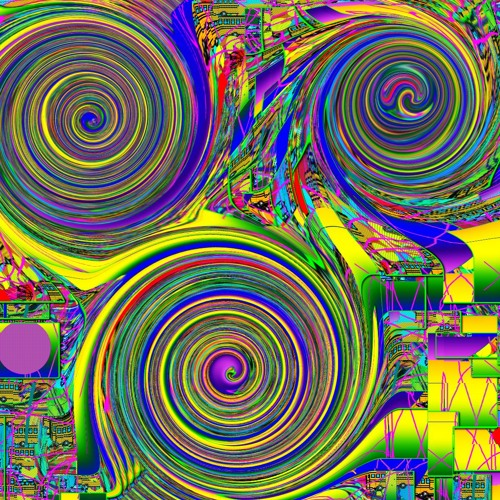

#  Trucbidule2435

Bienvenue sur mon site personnel, consacré à la musique, à la modélisation 3D, à Arduino et aux projets faits par curiosité.

**[Visiter le site](https://trucbidule2435.github.io/)**

## Les espaces

- **Musique** : mes productions et sélections à écouter sur [SoundCloud](https://soundcloud.com/trucbidul2435).
- **Modélisation 3D et simulations** : mes créations et circuits sur [Tinkercad](https://www.tinkercad.com/users/bolRJDM3N9F).
- **Arduino** : mes montages, capteurs et projets sur [Arduino Project Hub](https://projecthub.arduino.cc/trucbidul).

## À propos du site

Ce site rassemble mes projets et dirige vers leurs plateformes d’origine : SoundCloud, Tinkercad et Arduino Project Hub. Il est réalisé sans framework, en HTML, CSS et JavaScript, puis publié avec GitHub Pages.
